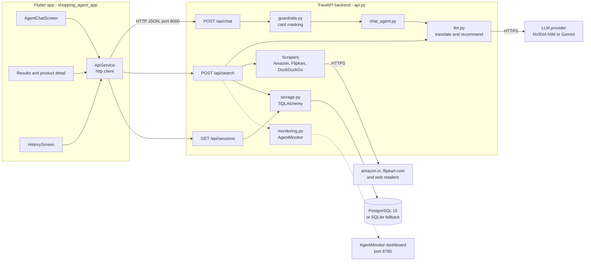
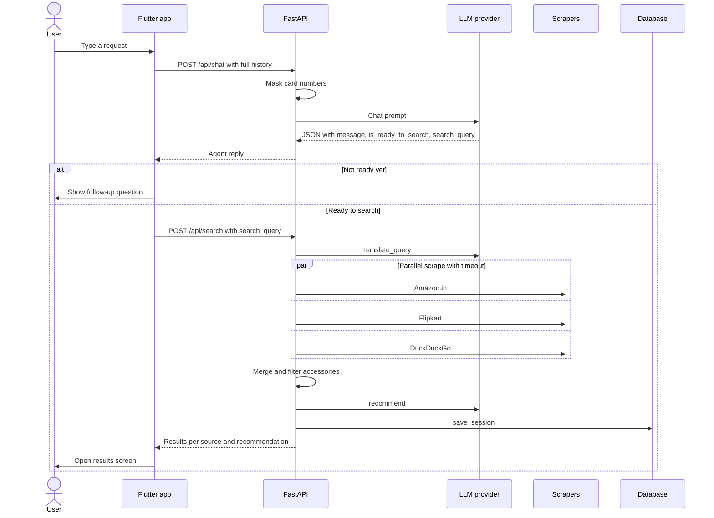
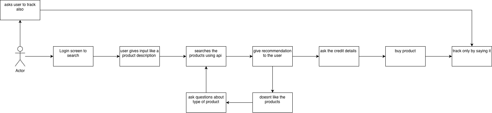

# 🛒 Personal AI Shopping Agent

**A conversational shopping assistant: chat about what you need, and the agent searches Amazon, Flipkart and the wider web in parallel, then has an LLM pick the best option.**


A full-stack, AI-powered personal shopping assistant. Through natural conversation it works out what you need (product, budget, features, brands). It masks card numbers typed into the chat, gathers live listings from **Amazon.in**, **Flipkart** and other Indian retailers found through **DuckDuckGo**, and asks an LLM to recommend the best-value option with a short explanation. Results and past searches are shown in a dark-themed **Flutter** app.

The backend is a Python **FastAPI** service that stores each search session in **PostgreSQL** (or SQLite for local development). It is packaged with **Docker Compose**. LLM calls go to **NVIDIA NIM** (OpenAI-compatible, Llama 3.1 8B Instruct by default) or **Google Gemini**. An optional **AgentMonitor** integration records every tool call for observability.

## 📋 Table of Contents

- [Features](#-features)
- [Architecture](#%EF%B8%8F-architecture)
- [Tech Stack](#%EF%B8%8F-tech-stack)
- [Project Structure](#-project-structure)
- [Getting Started](#-getting-started)
- [API](#-api)
- [Data Model](#%EF%B8%8F-data-model)
- [Deployment](#%EF%B8%8F-deployment)
- [Testing](#-testing)
- [Privacy and Known Limitations](#%EF%B8%8F-privacy-and-known-limitations)
- [Contributing](#-contributing)
- [License](#-license)
- [Authors](#-authors)

## ✨ Features

### Conversational discovery (`chat_agent.py`, `POST /api/chat`)
- **Smart interrogation.** The LLM decides whether it has enough to search. Vague requests like "laptop" get one or two follow-up questions. Specific requests like "i7 gaming laptop" go straight to search.
- **Structured replies.** Every turn returns `message`, `is_ready_to_search` and `search_query`.
- **Anti-loop guardrails.** A plain confirmation ("yes", "haan", "correct"…) forces a search using the user's own words. A reply repeated word for word is replaced with a request for more detail, and after four turns without a search the agent searches with what it has. Replies like `"is_ready_to_search": "false"` are parsed correctly. If the LLM fails three times, the agent searches with the user's words, or asks for them if the user only said hello. A missing API key returns `503` instead of a fake search.

### Search and recommendation (`POST /api/search`)
- **Any-language queries.** `translate_query` turns Hindi, Punjabi, English or mixed input into a concise 3–8 word English search query.
- **Parallel multi-source search.** A thread pool runs three sources with a configurable timeout:
  - **Amazon.in** (`scraper.py`): `curl_cffi` HTTP session plus BeautifulSoup parsing of search-result cards, with retries and CAPTCHA detection. Returns the top 10 results.
  - **Flipkart** (`flipkart_scraper.py`): fetches the search page and parses the embedded `window.__INITIAL_STATE__` JSON.
  - **Web** (`ddg_scraper.py`): DuckDuckGo search through `ddgs`. It excludes Amazon and Flipkart, keeps one result per domain, labels known Indian retailers (Croma, Myntra, Tata Cliq, Reliance Digital…) and extracts prices from snippets.
- **Accessory filter.** Bags, cases, chargers, cables and similar items are dropped unless the query asks for them.
- **LLM recommendation.** `recommend` filters strictly against the user's stated requirements and picks the best balance of price, rating and reviews, with a one- to three-sentence reason. If the JSON cannot be parsed, it falls back to the highest-rated product.
- **Session history.** Every search is saved with its original query, translated query, per-source results and recommendation.

### Reliability and observability
- `tenacity` retries every LLM call: three attempts with exponential backoff.
- With Gemini, the client falls back through `gemini-2.5-flash` → `gemini-2.0-flash-lite` → `gemini-2.0-flash` → `gemini-flash-latest` on quota or availability errors.
- Every response carries `X-Request-ID` and `X-Response-Time-Ms` headers. Logs are tagged with the request ID, in JSON when `LOG_FORMAT=json` (the production default).
- `/health` reports database and LLM status and returns `503` when the database is down. Docker and Compose health checks use it.
- **Slow or broken stores don't block a search.** Scrapers run on a shared pool. After `SCRAPE_TIMEOUT_SECONDS` the response goes out with whatever finished, and `source_status` reports each store as `ok`, `empty`, `failed` or `timeout`. A failed translation falls back to the raw text, and a failed recommendation falls back to the highest-rated product.
- **Normalised products.** Every product gets numeric `price_value`, `rating_value` and `reviews_value` fields, rupee prices are formatted with Indian grouping (`₹1,29,999`), and duplicates are removed. Accessory filtering matches whole words, so "Standard" no longer counts as a "stand".

### Production hardening (`config.py`, `middleware.py`)
- **Optional API key.** When `API_KEY` is set, every `/api/*` call needs `X-API-Key`.
- **Per-IP rate limits** for search, chat and reads. Exceeding them returns `429` with `Retry-After`.
- **Private history.** The app sends an anonymous per-install `X-Client-ID`, so each device only sees and deletes its own searches.
- Strict input validation, security headers, `/docs` off in production, and error responses that never leak internals.
- **AgentMonitor** ([HarsimarSingh23/AgentMonitor](https://github.com/HarsimarSingh23/AgentMonitor)) wraps the translate, scrape and recommend tools. It records arguments, results, latency and errors per search session and serves a live dashboard on port 8765. If the package is missing or `AGENT_MONITOR=0`, it becomes a no-op.

### Privacy guardrail (`guardrails.py`)
- Every chat message and search query is scanned for 13–19 digit card-like numbers, which are masked to the last four digits (`****-****-****-1234`) before they reach the LLM provider or the database.

### Flutter app (`shopping_agent_app/`)
- **Assistant** tab: a welcome screen with suggested requests, then a chat with typing indicators. While a search runs, a progress card shows each stage. Results appear inline as a top-pick card with the AI's reason, plus **Compare all** and **View deal** buttons. Errors show a **Try again** button, and a banner warns when the server is unreachable. Follow-ups like "show me cheaper ones" keep the context of the last search.
- **Results**: the AI top pick, store filters (All / Amazon / Flipkart / Other stores), sorting (best match, price low→high or high→low, top rated), and a notice when a store didn't respond.
- **Product detail**: the product photo on a white tile, price, rating, the AI's reason when it's the pick, copy link, and **Buy on {store}**, which opens the retailer's own page. The app never handles payments.
- **History** tab: past searches for this device with thumbnails and the top-pick price. Swipe to delete, clear all, and pull to refresh.
- Dark theme with neon-lime and pink accents, Google Fonts (Inter, Outfit), cached images, `flutter_animate` transitions, and a centred layout on tablets and the web.

### Terminal client (`agent.py`)
- An interactive CLI version of the search pipeline. It prints a results table and a recommendation box.

## 🏗️ Architecture



**Layers**

- **Flutter client.** `main.dart` hosts a bottom-navigation `IndexedStack` with the Chat and History tabs. All network calls go through the `ApiService` singleton. Chat and search requests time out after 120 s, other calls after 15 s.
- **API layer (`api.py`).** Defines the Pydantic request schemas, CORS, the request-ID middleware and the endpoints. At startup it initializes the database and the AgentMonitor dashboard.
- **Agent logic.** `chat_agent.py` handles the onboarding conversation. `llm.py` is the provider gateway: it chooses NVIDIA or Gemini through `LLM_PROVIDER`, and holds the translation and recommendation prompts.
- **Tools.** Three independent scrapers return a common product shape: `title`, `price`, `rating`, `reviews_count`, `url`, `image`, `source`.
- **Persistence.** `storage.py` uses PostgreSQL when `DATABASE_URL` is set. Otherwise it creates `results/sessions.db` (SQLite).

### Chat-to-recommendation flow



### Original concept



`amazon_arch.png` is the project's early concept flow. The login screen, credit-card entry, real purchasing and voice order tracking it shows are **not** implemented in the current code.

## 🛠️ Tech Stack

| Layer | Technology | Purpose |
|---|---|---|
| Mobile app | Flutter (Dart SDK `^3.8.1`), Material 3 dark theme | Cross-platform client |
| App packages | `http` ^1.6.0, `url_launcher` ^6.3.0, `shared_preferences` ^2.3.0, `cached_network_image` ^3.4.1, `google_fonts` ^6.2.1, `flutter_animate` ^4.5.0, `intl` ^0.20.1 | Networking, links, device ID, images, typography, animation, number and date formatting |
| API | FastAPI ≥ 0.111, Uvicorn ≥ 0.30, Pydantic | REST endpoints and validation |
| LLM | `openai` ≥ 1.30 (NVIDIA NIM, default `meta/llama-3.1-8b-instruct`), `google-genai` ≥ 2.7 (Gemini), `tenacity` | Chat, translation and recommendation |
| Scraping | `curl_cffi` ≥ 0.7.3 (browser impersonation), `beautifulsoup4`, `ddgs` ≥ 9.14 | Amazon.in, Flipkart and DuckDuckGo sources |
| Data | SQLAlchemy ≥ 2.0.30, `psycopg2-binary`, PostgreSQL 16 (Alpine image), SQLite fallback | Search-session storage |
| Observability | `agenticmonitor` (AgentMonitor, imported as `contextdb`) | Tool-call tracing and live dashboard |
| Config | `python-dotenv` | Loads `.env` |
| Infrastructure | Docker (`python:3.12-slim`, `tini`), Docker Compose | Containerized API and database |

## 📁 Project Structure

```
.
├── api.py                  # FastAPI app: endpoints, auth, rate limits, middleware, lifespan
├── config.py               # All settings, read from the environment
├── middleware.py           # Logging (text/JSON), request IDs, rate limiter
├── pipeline.py             # Search pipeline: translate → parallel scrape → normalise → recommend
├── products.py             # Product normalisation: prices, ratings, review counts, accessories
├── chat_agent.py           # Conversational onboarding prompt + anti-loop guardrails
├── llm.py                  # LLM gateway (NVIDIA NIM / Gemini), translate_query, recommend
├── scraper.py              # Amazon.in scraper (curl_cffi + BeautifulSoup)
├── flipkart_scraper.py     # Flipkart scraper (curl_cffi + embedded JSON state)
├── ddg_scraper.py          # DuckDuckGo web-retailer search
├── guardrails.py           # Card-number masking
├── storage.py              # SQLAlchemy model, per-device history, auto-migration
├── monitoring.py           # AgentMonitor integration (no-op when disabled)
├── agent.py                # Interactive terminal client
├── tests/                  # pytest suite (API, pipeline, chat guardrails, storage)
├── Dockerfile              # Slim API image (no browser)
├── docker-compose.yml      # PostgreSQL + API services
├── .env.example            # Every setting, documented
├── requirements.txt        # Runtime deps (+ requirements-dev.txt, requirements-monitoring.txt)
├── .github/workflows/ci.yml
├── amazon_arch.png         # Early concept flow diagram
└── shopping_agent_app/     # Flutter client
    ├── lib/
    │   ├── main.dart       # App entry, bottom navigation (Assistant / History)
    │   ├── config/         # app_config.dart (API_BASE_URL / API_KEY via --dart-define)
    │   ├── models/         # Product, SearchResponse, SessionSummary, ChatMessage
    │   ├── screens/        # agent_chat, search_results, product_detail, history
    │   ├── services/       # api_service.dart (HTTP client, errors, device ID)
    │   ├── theme/          # app_theme.dart (palette, source colours, ThemeData)
    │   ├── utils/          # formatters.dart (₹ formatting, time ago)
    │   └── widgets/        # chat_widgets, product_card, recommendation_card, product_bits, …
    ├── test/               # model and widget tests
    └── pubspec.yaml
```

## 🚀 Getting Started

### Prerequisites

- **Docker** and **Docker Compose**, for the containerized backend and database.
- **Python 3.12** (the Docker image version), for running the backend locally. AgentMonitor is optional (`requirements-monitoring.txt`, installed from GitHub, needs `git`).
- **Flutter SDK** with Dart ≥ 3.8.1 (`environment: sdk: ^3.8.1` in `pubspec.yaml`).
- An API key for **NVIDIA NIM** (default provider) or **Google Gemini**.

### Environment variables

Copy `.env.example` to `.env` in the repository root (it is git-ignored and excluded from the Docker image) and fill it in. The main settings:

| Variable | Description | Required |
|---|---|---|
| `APP_ENV` | `development` or `production`. Production switches on JSON logs, turns off `/docs` and warns about open CORS or a missing API key | No |
| `API_KEY` | When set, `/api/*` requires the `X-API-Key` header. The app sends it via `--dart-define=API_KEY=…` | Recommended in production |
| `RATE_LIMIT_SEARCH_PER_MIN` / `RATE_LIMIT_CHAT_PER_MIN` / `RATE_LIMIT_READ_PER_MIN` | Per-IP limits (defaults 10 / 30 / 120; `0` disables) | No |
| `LOG_LEVEL`, `LOG_FORMAT` | Log level and `text` or `json` | No |
| `LLM_PROVIDER` | `nvidia` (default) or `gemini` | No |
| `LLM_TIMEOUT_SECONDS` | Per-call LLM timeout (default `30`) | No |
| `NVIDIA_API_KEY` | NVIDIA NIM API key | When provider is `nvidia` |
| `NVIDIA_BASE_URL` | OpenAI-compatible endpoint. Defaults to NVIDIA's hosted API, and NVIDIA-specific reasoning options are only sent to `nvidia.com` URLs | No |
| `NVIDIA_MODEL` | Model id (default `meta/llama-3.1-8b-instruct`) | No |
| `NVIDIA_MAX_TOKENS` | Max tokens per completion (default `16384`) | No |
| `GEMINI_API_KEY` | Google Gemini API key | When provider is `gemini` |
| `DATABASE_URL` | SQLAlchemy URL for PostgreSQL. If unset, SQLite at `results/sessions.db` is used. Docker Compose sets it automatically | No |
| `POSTGRES_PASSWORD` | Password for the `shopping` database user in Docker Compose (also used to build `DATABASE_URL`) | For Docker Compose |
| `ALLOWED_ORIGINS` | Comma-separated CORS origins for the Flutter web build (default `*`) | Set in production |
| `SCRAPE_TIMEOUT_SECONDS` | How long a search waits for stores (default `45`) | No |
| `AGENT_MONITOR` | `1` to enable AgentMonitor (Compose defaults to `0`) | No |
| `AGENT_MONITOR_PORT` | Dashboard port (default `8765`) | No |
| `AGENT_MONITOR_OPEN` | Set to `1` to open the dashboard in a browser on startup | No |

`docker-compose.yml` passes all of these, including `LLM_PROVIDER` and `GEMINI_API_KEY`, to the container.

### Backend with Docker Compose

```bash
git clone https://github.com/HarsimarSingh23/personal_ai_agent_for_shopping.git
cd personal_ai_agent_for_shopping
cp .env.example .env   # then fill it in
docker compose up --build -d
```

- API: `http://localhost:8000` (health at `/health`; `/docs` is off in production unless `ENABLE_DOCS=true`)
- AgentMonitor dashboard (when enabled with `INSTALL_MONITORING=true` and `AGENT_MONITOR=1`): `http://127.0.0.1:8765`
- PostgreSQL is not published to the host. Uncomment the `ports` entry in `docker-compose.yml` to reach it on `127.0.0.1:5432`.

### Backend without Docker

```bash
python -m venv .venv
# Windows: .venv\Scripts\activate    macOS/Linux: source .venv/bin/activate
pip install -r requirements-dev.txt    # runtime deps + pytest
uvicorn api:app --reload --port 8000   # or: python api.py
```

Without `DATABASE_URL`, sessions go to SQLite at `results/sessions.db`.

You can also run the terminal client, or a single scraper on its own:

```bash
python agent.py                       # interactive CLI
python scraper.py "mechanical keyboard"
python flipkart_scraper.py "mechanical keyboard"
```

### Flutter app

```bash
cd shopping_agent_app
flutter pub get
flutter run
```

The backend URL and optional API key are passed at build time. Without `API_BASE_URL`, the app uses `http://10.0.2.2:8000` on the Android emulator and `http://127.0.0.1:8000` everywhere else.

```bash
flutter run --dart-define=API_BASE_URL=http://192.168.1.20:8000            # physical device on your LAN
flutter build appbundle --dart-define=API_BASE_URL=https://api.example.com --dart-define=API_KEY=...
```

## 🔌 API

When `API_KEY` is set, every `/api/*` request needs `X-API-Key`. Clients should send an anonymous, stable `X-Client-ID` (8–64 characters of `[A-Za-z0-9_-]`). History is scoped to it, and the Flutter app generates one per install. CORS is controlled by `ALLOWED_ORIGINS`.

| Method | Path | Request | Response |
|---|---|---|---|
| `GET` | `/health` | — | `{status, db, llm, version}`. `503` when the database is unreachable |
| `POST` | `/api/chat` | `{"history": [{"role", "content"}]}` (1–100 messages; roles `user` / `agent`) | `{message, is_ready_to_search, search_query}` |
| `POST` | `/api/search` | `{"query": "…"}` (2–200 characters) | `{session_id, query, results: {amazon, flipkart, web}, source_status, recommendation: {product, reason}}` |
| `GET` | `/api/sessions?limit=50&offset=0&summary=true` | — | This device's sessions, newest first. `summary=true` replaces product lists with `result_counts` |
| `GET` | `/api/sessions/last` | — | Most recent session, or `404` |
| `GET` | `/api/sessions/{session_id}` | — | One session, or `404` |
| `DELETE` | `/api/sessions/{session_id}` | — | `204`, or `404` if it isn't this device's |
| `DELETE` | `/api/sessions` | — | `{deleted: n}`. Clears this device's history (needs `X-Client-ID`) |

Errors are JSON `{detail}`: `401` bad API key, `422` invalid input, `429` rate-limited (with `Retry-After`), `503` LLM not configured. If no products are found, `/api/search` returns empty result lists with a `message`.

## 🗄️ Data Model

A single table, `sessions`, is created automatically at startup. Columns added later (such as `client_id`) are migrated in place on existing databases.

| Column | Type | Notes |
|---|---|---|
| `session_id` | `String` (PK) | UUID4 |
| `timestamp` | `DateTime(timezone=True)` | Defaults to now (UTC) |
| `client_id` | `String(64)`, indexed with `timestamp` | Anonymous device ID. Rows saved before this column existed are `NULL` and only visible to clients that send no ID |
| `query_original` | `String` | What the user (or chat agent) sent |
| `query_english` | `String` | LLM-translated search query |
| `results` | `JSON` | `{amazon: [...], flipkart: [...], web: [...]}` product lists |
| `recommendation` | `JSON` | `{product: {...}, reason: "..."}` |

## ☁️ Deployment

`docker-compose.yml` defines two services:

- **`db`**: `postgres:16-alpine`, with a `pg_isready` health check and a named volume `postgres_data`. It is not published to the host.
- **`api`**: built from the `Dockerfile`. It publishes port `8000`, binds the AgentMonitor port `8765` to localhost only, starts once `db` is healthy, checks `/health`, and rotates its logs. `POSTGRES_PASSWORD` must be set or Compose refuses to start.

The `Dockerfile` starts from `python:3.12-slim` and installs only `curl` and `tini` (the scrapers need no browser). It copies just the Python sources, `.dockerignore` keeps `.env`, `results/` and the Flutter app out of the image, and it runs as a non-root `appuser`. `INSTALL_MONITORING=true` adds AgentMonitor at build time. Uvicorn runs with `--proxy-headers`. Set `FORWARDED_ALLOW_IPS` to your reverse proxy's address so rate limits see real client IPs. Rate limits are in-memory per worker, so put a shared limiter (Redis or your gateway) in front when running several instances.

**Production checklist:** set `APP_ENV=production`, a strong `POSTGRES_PASSWORD`, `API_KEY`, and `ALLOWED_ORIGINS`, and serve the API over HTTPS behind a reverse proxy. For the app, give it a real Android `applicationId` / iOS bundle ID (it is still `com.example.shopping_agent_app`) and configure release signing.

## 🧪 Testing

```bash
pip install -r requirements-dev.txt && pytest          # backend: API, pipeline, chat guardrails, storage migration
cd shopping_agent_app && flutter analyze && flutter test   # app: models, sorting, chat → search flow
```

Backend tests replace the scrapers and LLM with fakes, so they need no network or API keys. GitHub Actions (`.github/workflows/ci.yml`) runs both suites and builds the Docker image on every push and pull request.

## 🛡️ Privacy and Known Limitations

- **Scrapers depend on third-party markup and bot protection.** Results can drop to zero when Amazon, Flipkart or DuckDuckGo change their pages or rate-limit requests. The app tells the user which store didn't respond. Use the scrapers in line with each site's terms of service; affiliate or partner APIs are the long-term fix.
- **The API key is a soft gate.** A key compiled into a mobile app can be extracted. Rate limits are the real abuse control. For stronger protection, add user accounts or platform attestation (Play Integrity / App Attest).
- **Device-scoped history, not accounts.** Reinstalling the app or clearing its data creates a new device ID, and the old history is no longer visible.
- **No checkout.** Purchases happen on the retailer's site. The app only links there.

## 🤝 Contributing

1. Fork the repository and create a feature branch.
2. Keep the product dictionary shape (`title`, `price`, `rating`, `reviews_count`, `url`, `image`, `source`) consistent across scrapers. `products.normalize` adds the numeric fields, and the API, LLM prompt and Flutter models depend on that shape.
3. Run `pytest` and `flutter analyze && flutter test` before opening a PR. CI runs both.
4. Open a pull request against [HarsimarSingh23/personal_ai_agent_for_shopping](https://github.com/HarsimarSingh23/personal_ai_agent_for_shopping).

## 📄 License

This project does not currently include an open-source license. All rights reserved by the repository owner.

## 👥 Authors

**Harsimar Singh**: repository owner, [@HarsimarSingh23](https://github.com/HarsimarSingh23)

**Contributors** (from the git history):

- Gurjot Singh
- Harsimar Singh
